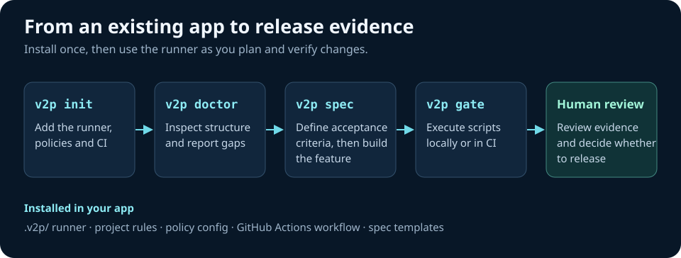

# Vibe-to-Prod

**Agent-native production guardrails for applications built with AI.**


> **Working-name notice:** `vibe-to-prod` is already used by [muyen/vibe-to-prod](https://github.com/muyen/vibe-to-prod), a separate existing project. This prototype has no affiliation with it. Choose and clear a distinct public brand before publishing. `v2p` is a temporary local CLI command, not a reserved npm name.

> From vibe coding to verifiable engineering. Keep the speed of AI-assisted development without treating a passing demo as a production release.

[](#production-behavior-and-limitations) [](LICENSE)

## Why this exists

Vibe coding is fast until schema changes, authorization paths and untested edge cases accumulate. A prompt describing "senior-level quality" cannot enforce it. `vibe-to-prod` supplies executable guardrails, evidence-based diagnostics, agent instructions and a local CI gate runner that can be installed **into existing codebases** without replacing your coding agent.

**Product promise (target):** An AI-native development system with full-stack starter recipes, tested auth/database/billing integrations, reproducible CI/CD and independent release evidence.

**What this MVP actually ships:** A self-contained, safe-to-install CLI with policy files, a reusable local gate runner, feature-spec generator and source-available tests. Auth, DB and payments are **detected as signals**, not installed or certified. Production starters and deployment automation are on the roadmap.

## Quick start — from source (not yet published to npm)

Prerequisites: Node.js 22+, npm, a JavaScript or TypeScript project; Git recommended.

```bash
# Download/extract this repository, then:
node /absolute/path/to/vibe-to-prod/bin/v2p.mjs init /path/to/your-app
cd /path/to/your-app

# Independent runner is now installed inside your repo:
node .v2p/bin/v2p.mjs doctor
node .v2p/bin/v2p.mjs spec team-invitations
node .v2p/bin/v2p.mjs gate
```

This deliberately starts with an **existing application**. To create a SaaS baseline, begin with the publicly maintained [Next.js SaaS Starter](https://github.com/nextjs/saas-starter) (review its current dependencies, security and license) and then run `v2p init`. A separate `v2p new` template generator is planned; it is not implemented yet.

## Install Addy Osmani agent skills

The [MIT-licensed addyosmani/agent-skills](https://github.com/addyosmani/agent-skills) is the upstream source of engineering workflows. We do not silently fetch or vendor this pack.

```bash
npx skills add addyosmani/agent-skills --list
npx skills add addyosmani/agent-skills
```

You can also explicitly request it through the CLI with `node .v2p/bin/v2p.mjs skills install` (network access required). Review the selected installation scope; configure Cursor's `.cursor/skills/` vs project-level skills according to the [official Cursor guide](https://github.com/addyosmani/agent-skills/blob/main/docs/cursor-setup.md). We never copy the upstream repository's root `AGENTS.md` because it describes the upstream project, not yours.

## Commands

| Command | What it actually does | Enforced? |
|---|---|---|
| `v2p init` | Adds versioned local runner, scoped agent rules, PRD/spec structure, CI and policy | Non-destructive; skips existing files |
| `v2p doctor --json` | Examines strict TS, scripts, CI, env contracts, known auth/DB/payment dependencies, migration directory, basic secret hygiene | Structural checks; no runtime claims |
| `v2p doctor --strict` | Returns failure when configured structural blockers are missing | Yes |
| `v2p spec <slug>` | Generates a feature spec with acceptance/security/release evidence checklists | Prevents overwrites |
| `v2p gate` | Runs declared typecheck/lint/test/build scripts and fails on execution errors or configured missing requirements | Yes |
| `v2p gate --audit` | Adds `npm audit` (requires npm lockfile and network access) | Yes when requested |
| `v2p skills install` | Calls official skills installer after explicit user action | Upstream install, not automatic |

`v2p gate --json` produces a machine-readable evidence report to stdout. It does not contain a security or operational certification.

## Core architecture



The installed `AGENTS.md` and `.cursor/rules/*.mdc` guide implementation. Addy Osmani's skills can supplement that workflow. See [technical architecture](docs/ARCHITECTURE.md#quality-pipeline) for the gate's pass and fail conditions.

**Source layout**

```text
bin/v2p.mjs            # CLI entry
src/audit.mjs          # evidence-aware static checks
src/gate.mjs           # actual command execution (exit-code based)
src/init.mjs           # non-destructive installer + local runner copy
src/spec.mjs           # scoped requirements generator
templates/             # project instructions, Cursor rules, CI and ADRs
tests/                 # Node built-in test suite
docs/                  # product/technical strategy and milestones
```

## Production behavior and limitations

- This is a **developer tooling MVP**, not a turnkey hosted app, billing system, online AI model or autonomous agent.
- `.cursor/rules/*.mdc` is the current Cursor project-rules format. `.cursorrules` is legacy; no giant always-on prompt files.
- `AGENTS.md` makes instructions portable across compatible agents; installing skills remains a separate step.
- An installed authentication dependency does **not** prove authorization, CSRF protection or secure session handling. Tenant isolation needs negative-path integration tests.
- A migration directory does **not** prove safe up/down database migrations, rollback or data integrity.
- The generated CI currently assumes npm and Node 22. You must adapt it for other package managers; `npm ci --ignore-scripts` may require deliberate adjustment for your dependency stack.
- `npm audit` is optional because a network outage is not a vulnerability finding. Production pipelines should add pinned secret scanning, dependency review, SAST, integration/E2E tests and environment-specific deploy checks.
- We do not claim any deployed, independently security-audited, or production-proven application.

## Contributing

Run `npm test` and `npm run check`. File a reproducible issue with observed vs expected behavior. Contributions should ship tests and documented proof for all new checks. Keep sources MIT-compatible and preserve original licensing notices for any imported materials. See [CONTRIBUTING.md](CONTRIBUTING.md).

## Roadmap

See [docs/ROADMAP.md](docs/ROADMAP.md) for a phased release plan; [docs/PRODUCT_STRATEGY.md](docs/PRODUCT_STRATEGY.md) for positioning and benchmarks. MIT licensed. Not affiliated with Addy Osmani, Anthropic, GitHub, Vercel or Cursor.
