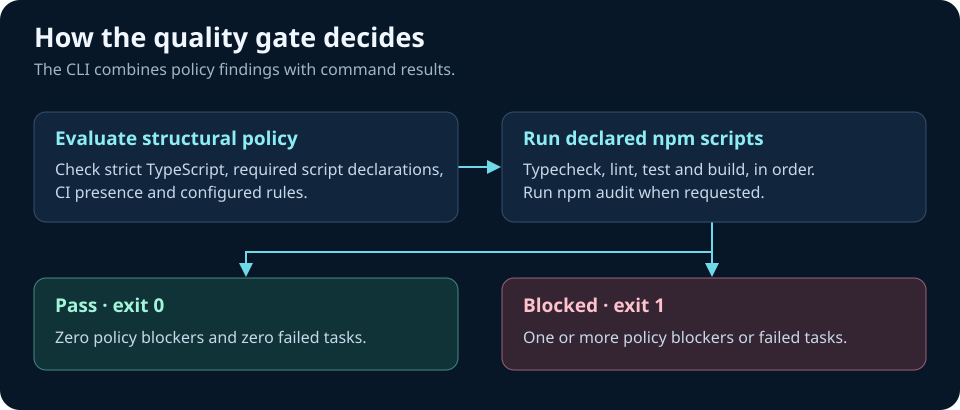

# Technical architecture — version 0.1

## Scope

A Node.js 22 ESM CLI using built-in APIs, no runtime third-party dependencies. It adds project instructions, copies itself into `.v2p/` so the CI gate does not require an npm publication, verifies structural quality signals and runs actual package scripts. The tool is deliberately non-destructive and does not contact model providers.

## Boundary and threat model

- Local filesystem access is scoped to an explicitly selected project directory. Avoid installing into untrusted directories or running gate commands from untrusted repositories: package scripts run locally with current user privileges.
- `init` does not overwrite existing paths; installs a versioned source snapshot. Users must review it and intentionally update later.
- Input sanitization prevents path traversal in spec names. File existence checks may be conservative in complex mono-repos.
- `doctor` is a heuristic scanner; it must not claim that auth, secrets, migrations, tests or payment behavior are correct based on file presence alone.
- `gate` executes scripts declared in package.json; users should treat these as arbitrary code. It runs with `CI=true`; command execution does not use a shell wrapper constructed by this CLI. npm itself executes user-defined package scripts.
- CI is npm-only for now; future package-manager adapters must be explicitly tested.

## Quality pipeline

Review the evidence before making a release decision.

The immutable baseline blockers are strict TS, typecheck script, test script, build script and CI workflow presence. Missing lint is recommended but `gate` runs it if present. Teams can add any recognized check ID to `v2p.config.json blocking_checks`.

## Planned extension points

- Language adapters: TS/JS then Python, Go.
- Framework adapters: Next.js then React Router, Nuxt, Django.
- Policy engine: policy version/hash, OPA/Rego or JSON Schema for evidence output.
- Deployment recipes: Vercel, Fly, Cloudflare, Docker/Kubernetes.
- Test harness: browser automation, tenant-negative tests, migration drift and rollbacks, security scanning.
- Signed evidence package: checksums, commit SHA, tool versions, CI URL, signed attestations.

No numeric 'production score' without a published reproducible rubric and measured false-positive rate.
